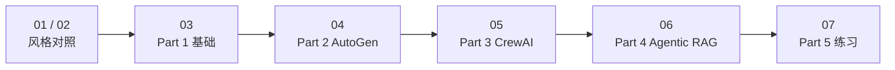

# 04 · 多 Agent 框架实战

本目录用 **两个纯 Python 对照脚本 + 五个 Notebook**，把多 Agent 系统从「概念」讲到「能跑、能观测、能兜底」：

- 先看两种框架风格的最小实现（LangGraph 风格 / Crew 风格）
- 再依次学习 **AutoGen**、**CrewAI**、**LangGraph**
- 最后用一道 Agentic RAG 实战 + 三道练习收尾

编号沿用课程全局顺序：**Part 1** 基础 → **Part 2** AutoGen → **Part 3** CrewAI → **Part 4** Agentic RAG → **Part 5** 练习。

---

## 目录结构

```text
04_frameworks/
├── 01-langgraph_style.py              # LangGraph 风格极简实现（纯标准库）
├── 02-crew_style.py                   # Crew 风格极简实现（纯标准库）
├── 03-环境初始化与MAS基础.ipynb        # Part 1：概念 + 依赖安装 + 环境变量
├── 04-autogen_实战.ipynb              # Part 2：AutoGen 的 GraphFlow / Selector / Memory
├── 05-crewai_实战.ipynb               # Part 3：CrewAI 的顺序 / 层级 / 工具
├── 06-agentic_rag与框架对比.ipynb      # Part 4：三框架对比 + Agentic RAG 实战
└── 07-练习.ipynb                      # Part 5：三道课堂练习
```

| 文件 | 类型 | 核心内容 | 需要 API |
| --- | --- | --- | --- |
| `01-langgraph_style.py` | Python 脚本 | 节点 + 边 + 共享 state 的图执行模型 | 否 |
| `02-crew_style.py` | Python 脚本 | Role / Task / Crew 的顺序执行模型 | 否 |
| `03-环境初始化与MAS基础.ipynb` | Notebook | 多 Agent 基础概念、架构模式、可观测性、依赖与环境 | 否（仅需 Key） |
| `04-autogen_实战.ipynb` | Notebook | `GraphFlow`、`SelectorGroupChat`、`Memory` | 是 |
| `05-crewai_实战.ipynb` | Notebook | Sequential / Hierarchical / Tools | 是（3C 需 Tavily） |
| `06-agentic_rag与框架对比.ipynb` | Notebook | 三框架建模对比、选型、LangGraph Agentic RAG | 是 |
| `07-练习.ipynb` | Notebook | 三角色流水线、消息队列 Pipeline、Supervisor + HITL | A/C 需要 |

---

## 推荐学习路径



1. **01 / 02**：先用两段不超过 100 行的代码，建立「图驱动」和「任务驱动」两种直觉。
2. **03**：补齐多 Agent 的概念与工程常识，同时把依赖和环境变量准备好。
3. **04 / 05**：分别上手 AutoGen 与 CrewAI，重点看同一场景如何用不同抽象表达。
4. **06**：把三者放在一起对比，再用 LangGraph 写出完整的 Agentic RAG。
5. **07**：独立完成三道练习，检验是否真的掌握了编排、并发与治理。

---

## 环境准备

项目在**仓库根目录**统一管理依赖（`pyproject.toml` / `uv.lock` → `.venv`），Python 版本为 3.13。

```bash
# 在仓库根目录执行
uv sync

# 准备环境变量
cp .env.example .env
# 编辑 .env，至少填入 OPENROUTER_API_KEY
```

`.env` 需要放在**仓库根目录**（不是本目录）：

| 变量 | 是否必需 | 用途 |
| --- | --- | --- |
| `OPENROUTER_API_KEY` | 必需 | 所有 Notebook 中的 LLM 调用 |
| `TAVILY_API_KEY` | 可选 | 05 的示例 3C（联网搜索） |

模型通过 OpenRouter 的 OpenAI 兼容接口访问：

| 别名 | 模型 | 用途 |
| --- | --- | --- |
| `MODEL_SONNET` | `anthropic/claude-sonnet-4-5` | 生成、写作等质量优先的任务 |
| `MODEL_HAIKU` | `anthropic/claude-haiku-4-5` | 精排、校验等轻量任务 |

> Notebook 的 Kernel 请选择 `./.venv/bin/python`（或注册好的 `multi-agent` 内核），否则会出现「装了却 import 不到」。

---

## 快速开始

### 运行两个 Python 脚本

两个脚本只依赖标准库，**不需要 API Key**，可以直接观察数据结构与执行顺序：

```bash
# 在仓库根目录执行
uv run python 04_frameworks/01-langgraph_style.py
uv run python 04_frameworks/02-crew_style.py
```

> 没有安装 `uv` 也可以直接使用项目虚拟环境：`.venv/bin/python 04_frameworks/01-langgraph_style.py`。

预期输出（节选）：

```text
=== LangGraph 风格：节点 + 边 + 状态 ===
  task: 实现登录 API
  plan: 1. 定义 POST /login ...
  code: def login(u, p): ...
  test: assert login('a', 'b')['token']

=== Crew 风格：角色 + 任务列表 ===
--- 写用户故事 ---
用户故事：作为用户，我希望用账号密码登录并获得 token。
...
```

### 运行 Notebook

按 **03 → 04 → 05 → 06 → 07** 的顺序打开，每个 Notebook 都从顶部按顺序执行。

`07-练习.ipynb` 的练习 C 复用 `06` 中定义的节点函数，需要先在同一 Kernel 中运行完 `06` 的 **4.3 节 Step 1 – Step 8**；代码里有前置检查，缺少时会给出明确提示。

---

## 文件说明

### `01-langgraph_style.py` — 图 = 节点 + 边 + 状态

用 `SimpleGraph` 模拟 LangGraph 的核心心智模型：

- `add_node(name, fn)`：节点是一个 `state -> state` 的函数
- `add_edge(src, dst)`：边决定下一步去哪
- `set_entry_point(name)`：入口节点
- `invoke(state)`：沿边逐个执行，直到没有后继节点

示例链路为 `plan → code → test`，每个节点只往共享 `state` 里写自己的字段。

> 对应真实 LangGraph 的 `StateGraph`，区别只是真实框架提供了条件边、checkpoint、并行与持久化。

### `02-crew_style.py` — 角色 + 任务列表

用 `Role` / `Task` / `run_crew` 模拟 CrewAI 的组织方式：

- `Role(name, goal, backstory)`：定义「谁来做」
- `Task(description, agent)`：定义「做什么、交给谁」
- `run_crew(...)`：按任务顺序执行，把上一步输出追加到上下文
- `mock_model(...)`：占位 LLM，保证脚本离线可跑

重点观察两件事：**任务顺序即流程**、**上下文靠字符串拼接传递**。

### `03-环境初始化与MAS基础.ipynb` — Part 1

- `1.1`–`1.8`：为什么需要多 Agent、复杂任务的本质、常见架构模式、Agent 生命周期、通信方式、可观测性、监督与治理
- `1.9`：依赖安装（`uv add` / `uv sync`）
- `1.10`：读取 `.env`，导出 `OPENROUTER_API_KEY` / `MODEL_SONNET` / `MODEL_HAIKU`

后续每个 Notebook 也会各自加载一次环境变量，因此可以单独运行。

### `04-autogen_实战.ipynb` — Part 2

- `2.1 概念`：AgentChat 与 Core 两层心智模型、Agent / Message / Team / Termination、Tool Use 边界、Guardrails、Trace 与 HITL
- `2.2 AutoGen 实战`
  - `示例 2A` — `GraphFlow`：Researcher → Writer → Editor 的 DAG 流水线
  - `示例 2B` — `SelectorGroupChat`：由 LLM 动态选择下一位发言者
  - `示例 2C` — `Memory`：给 Agent 增加可复用的用户记忆

### `05-crewai_实战.ipynb` — Part 3

- `3.1 概念`：Agent / Task / Crew / Process、Sequential 与 Hierarchical、Tools / Knowledge / Memory、Planning 与 Delegation、Retry 与可观测性
- `3.2 CrewAI 实战`
  - `示例 3A` — 顺序流水线 Crew：研究 → 写作 → 审校
  - `示例 3B` — 层级制 Crew：由 manager 负责委派与验收
  - `示例 3C` — 带工具的 Crew：接入 Tavily 联网搜索

### `06-agentic_rag与框架对比.ipynb` — Part 4

- `4.1`：同一场景的三种建模方式（`示例 4A` AutoGen 风格、`4B` CrewAI 风格、`4C` LangGraph 风格）
- `4.2`：三框架在总览 / 架构 / 工程三个维度的对比表与选型建议
- `4.3`：Agentic RAG 实战，用 `StateGraph` 串起 10 个步骤

```text
START → retriever → reranker → generator → verifier ─┬─ pass → accept → END
                                                      └─ fail → review（HITL）
```

| 节点 | 职责 | 模型 |
| --- | --- | --- |
| `retriever` | 关键词粗检索 | 无 |
| `reranker` | 精排 top-3 | Haiku |
| `generator` | 生成草稿 | Sonnet |
| `verifier` | 一致性校验 + 置信度 | Haiku |
| `accept` / `review` | 二元出口 | 无 |

- `4.4`：回顾、练习与常见陷阱

### `07-练习.ipynb` — Part 5

- `5.1 练习 A（入门）`：用 AutoGen `GraphFlow` 实现三角色流水线，含 TODO 骨架与参考答案
- `5.2 练习 B（进阶）`：用 `queue.Queue` 实现 Retriever / Generator / Verifier 三级 Worker 的并发 Pipeline，并观察队列长度、延迟与 Worker 健康度
- `5.3 练习 C（挑战）`：实现 Supervisor + HITL，把低通过率的结果路由到人工审查队列，并记录决策
- 末尾附调试清单、评估标准与提交要求

> 练习 A、B 自带初始化代码，可独立运行；练习 C 需要在同一 Kernel 中先运行 `06` 的 4.3 节。

---

## 编号约定

| 层级 | 格式 | 示例 |
| --- | --- | --- |
| Notebook 标题 | `N. 标题` | `# 3. CrewAI：定位与设计哲学` |
| 一级小节 | `N.M 标题` | `## 3.2 CrewAI 实战` |
| 示例 | `示例 NA / NB / NC` | `示例 3A`、`示例 4C` |
| 实战步骤 | `Step 1 … Step N` | `Step 8 — 组装 StateGraph` |
| 练习 | `练习 A / B / C` | `5.2 练习 B` |

---

## 常见问题

**`ModuleNotFoundError: No module named 'autogen_agentchat'`**

Kernel 选错了。把 Notebook 右上角的 Kernel 切换到 `./.venv/bin/python`，或先执行 `uv sync`。

**`OSError: OPENROUTER_API_KEY 未设置`**

`.env` 不在仓库根目录，或没有填写 Key。可参考 `.env.example`：

```bash
OPENROUTER_API_KEY=sk-or-v1-...
TAVILY_API_KEY=
```

**`draw_mermaid_png()` 报错**

图可视化依赖网络；代码已做 `try/except`，失败时会退回文字描述的流程，不影响后续运行。

**练习 C 抛出 `RuntimeError: 缺少 AgenticRAGState...`**

先在同一 Kernel 中顺序执行 `06-agentic_rag与框架对比.ipynb` 的 **4.3 节 Step 1 – Step 8**。

**调用很慢或成本偏高**

确认轻量任务（精排、校验）使用的是 `MODEL_HAIKU`，只有生成环节使用 `MODEL_SONNET`；调试时可以把 `max_tokens` 调小。

---

## 与其它目录的关系

| 目录 | 内容 |
| --- | --- |
| `01_introduction/` | 单 Agent 与多 Agent 的概念、协作模式、通信方式 |
| `02_architecture/` | 多 Agent 架构演示 |
| `03_control_and_orchestrate/` | 阶段状态机、任务路由、冲突解决 |
| **`04_frameworks/`** | **具体框架落地：AutoGen、CrewAI、LangGraph 与 Agentic RAG** |

前三个目录偏「框架无关的通用原理」，本目录回答的是「用哪个框架、怎么写出来」。
